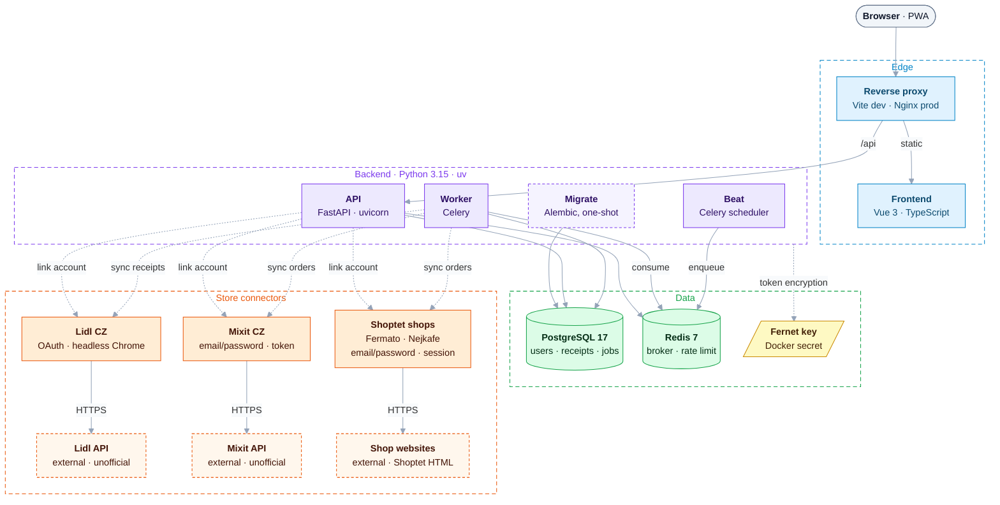

# Cartalytix

Self-hosted PWA (mobile and desktop) receipt tracker and analyzer

Available connectors:

- Globus
- Lidl
- Kaufland
- Mixit
- Fermato
- Nejkafe
- Wolt
- Bolt
- Foodora

Comming soon

- Košík
- Rohlík
- Albert

Feel free to create a fork and PR with new connector or function.

| Path | Purpose |
| --- | --- |
| `backend/` | Python 3.15, FastAPI, SQLAlchemy, Alembic, Celery; managed by uv |
| `frontend/` | Vue, TypeScript, Vite, Vue Query, Vue I18n, PWA |
| `experiments/` | Prototypes and experimental connectors |
| `ARCHITECTURE.md` | Approved direction and remaining decisions |

## Architecture



Connectors run in-process in the API (login) and worker (sync); there is no
separate connector service. Jobs are persisted in PostgreSQL, so a Redis outage
delays but does not lose them.

## Local setup

Requires Docker Compose. Node and Vite run in the frontend container.
Copy `.env.example` to `.env`. Set a random URL-safe `POSTGRES_PASSWORD` and a
strong `CARTALYTIX_BOOTSTRAP_PASSWORD`.
There is no public registration.

```powershell
uv --directory backend sync --locked --extra browser
uv --directory backend run --no-sync python -c "from pathlib import Path; from cryptography.fernet import Fernet; p=Path('../.secrets/token.key'); p.parent.mkdir(exist_ok=True); p.open('xb').write(Fernet.generate_key())"
docker compose build
docker compose up -d
```

On first start with an empty database, sign in as `admin@example.com` with
`CARTALYTIX_BOOTSTRAP_PASSWORD`. The first sign-in requires a new e-mail and
password. Remove the bootstrap password from the environment after setup.
The administrator only manages accounts
(Account management tab): it creates users with a generated one-time password,
resets passwords, disables and deletes accounts, and never sees store data.
Users created or reset by the administrator must change the password at first
sign-in. `cartalytix create-user` still provisions a regular user from the
terminal; enter its password at the prompt, never in a command or chat.

After initial setup, start development with `docker compose build` and
`docker compose up -d`; no override files are needed. Migrations run before
the API and workers start.

The frontend runs Vite at `http://localhost:8080` (or `FRONTEND_PORT` from `.env`),
listens on all interfaces, and proxies `/api/` to FastAPI inside Docker.
Frontend source changes reload automatically. For mobile testing on the same
Wi-Fi, use the computer's IP and add that exact origin to
`CARTALYTIX_ALLOWED_ORIGINS` in `.env`. The API is bound to `127.0.0.1:8000`;
PostgreSQL and Redis have no published ports. No local Nginx or `work/` files
are required. This Compose setup is for development. In production the
`frontend` image (Dockerfile target `production`) serves the build with Nginx and
forwards `/api/`, `/mcp` and OAuth discovery to the API; the external HTTPS proxy
only forwards the whole origin to its port.

## Release

Set the same version in `backend/pyproject.toml` (then `uv lock`) and
`frontend/package.json`, merge to `main`, then push tag `vX.Y.Z`. The Release
workflow runs CI, pushes `ghcr.io/stecik/cartalytix-{backend,frontend}` as
`X.Y.Z` and `latest` and creates the GitHub release with generated notes.

Create the encryption key once; keep it outside Git and back it up separately
from the database. `TOKEN_KEY_PATH` overrides its host path. Losing or replacing
the key requires reconnecting all store accounts.

## MCP connector (ChatGPT, Codex, Claude)

Each user connects their own Cartalytix account to ChatGPT, Codex or Claude through the
MCP endpoint `/mcp` (Streamable HTTP). There is no OpenAI API key and no
central service. The backend is its own OAuth 2.1 authorization server: dynamic
client registration, PKCE S256, `resource`-bound tokens. Scope `cartalytix:read` is
mandatory; `cartalytix:categories:write`, `cartalytix:calculator` and `cartalytix:exclusions:write`
are off by default
and enabled on the consent page or later per connection. Permissions are stored on the
grant, so changes apply to live tokens immediately and survive refresh.
Tokens are opaque, stored only as SHA-256 hashes in PostgreSQL (access 1 h, rotated
refresh 30 days), so they work across workers and restarts. The owner comes only
from the verified token; tools never accept a user id. Users change permissions or
revoke access under **Settings → Connected AI apps**.

### ChatGPT

1. Open `chatgpt.com/plugins` → **+** → **Add custom MCP server**.
2. Server URL `https://cartalytix.example.com/mcp`, authentication **OAuth**; leave static
   client credentials empty (the client registers itself).
3. Confirm the warning, **Create**, then install the plugin.
4. On first use sign in with the Cartalytix account and choose **Allow access**.

Custom MCP servers may require developer mode depending on the ChatGPT plan.

### Codex

```powershell
codex mcp add cartalytix --url https://cartalytix.example.com/mcp
codex mcp login cartalytix
codex mcp list
```

`add` detects OAuth and starts the login itself; `login` repeats it. Sign in and
allow access in the browser; `codex mcp list` then shows `Auth: OAuth`.

For local testing use `CARTALYTIX_PUBLIC_URL=http://localhost:8080` (HTTP is
allowed only for localhost outside production); Vite proxies the MCP paths.

### Deployment

1. Set `CARTALYTIX_PUBLIC_URL=https://cartalytix.example.com` for the API (add it to the
   Compose backend environment). Without it the connector is disabled. URLs are
   derived from this setting, never from the `Host` header.
2. `CARTALYTIX_TOKEN_KEY_FILE` is required (registered client secrets are
   Fernet-encrypted); `https://cartalytix.example.com` must be in `CARTALYTIX_ALLOWED_ORIGINS`.
3. Migration `0010_mcp_oauth` runs with the usual `migrate` service.
4. Nginx must forward to the API, besides `/api/`:
   - `/mcp`
   - `/.well-known/oauth-protected-resource` and `/.well-known/oauth-protected-resource/mcp`
   - `/.well-known/oauth-authorization-server` and
     `/.well-known/oauth-authorization-server/api/v1/oauth`
5. Keep the original host: `proxy_set_header Host $host;` (other hosts get `421`).

The OAuth issuer is `https://cartalytix.example.com/api/v1/oauth`; the consent page is the
frontend route `/oauth/consent`. Client registration accepts only ChatGPT
redirects (`https://chatgpt.com/connector_platform_oauth_redirect`,
`https://chatgpt.com/connector/oauth/{id}`) and loopback HTTP redirects (Codex).
