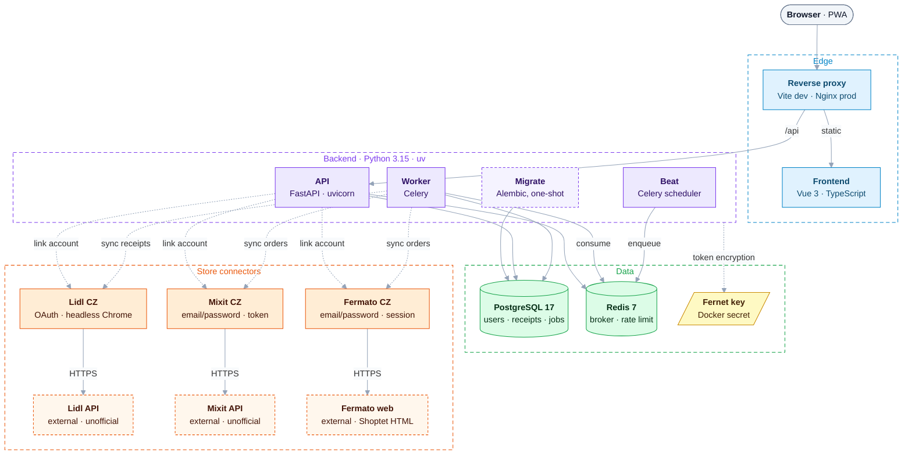

# Cartalytix

Self-hosted receipt tracker. First application slice: local password accounts,
owner-scoped receipt APIs, SQL totals per currency and an English/Czech Vue PWA.
The Lidl CZ connector imports receipt history, source items and discounts.
The Mixit.cz connector imports shipped orders (products and mixes); Mixit does not
itemize shipping, vouchers or credits, so the difference to the paid total is stored
as a "Shipping and fees" item or a "Discounts and credits" order discount.
The Fermato.cz connector (Shoptet customer area, HTML) imports all orders; the
password is stored Fernet-encrypted because Shoptet has no refresh token. Paid fees
become items, coupons order discounts, Shoptet whole-CZK rounding `rounding_amount`;
orders shown as 0 Kč use the sum of their lines.
Other stores remain unavailable. The original Lidl experiment remains in `experiments/`.

| Path | Purpose |
| --- | --- |
| `backend/` | Python 3.15, FastAPI, SQLAlchemy, Alembic, Celery; managed by uv |
| `frontend/` | Vue, TypeScript, Vite, Vue Query, Vue I18n, PWA |
| `experiments/` | Lidl prototype and `provider-research.md` |
| `ARCHITECTURE.md` | Approved direction and remaining decisions |

## Architecture



Connectors run in-process in the API (login) and worker (sync); there is no
separate connector service. Jobs are persisted in PostgreSQL, so a Redis outage
delays but does not lose them.

## Local setup

Requires Docker Compose. Node and Vite run in the frontend container.
Copy `.env.example` to `.env` and set a random URL-safe `POSTGRES_PASSWORD`.
There are no default application credentials or public registration.

```powershell
uv --directory backend sync --locked --extra browser
uv --directory backend run --no-sync python -c "from pathlib import Path; from cryptography.fernet import Fernet; p=Path('../.secrets/lidl.key'); p.parent.mkdir(exist_ok=True); p.open('xb').write(Fernet.generate_key())"
docker compose build
docker compose up -d
docker compose exec api uv run --no-sync cartalytix create-user
```

Enter the account password at the terminal prompt; never put it in a command or
chat. After initial setup, start development with `docker compose build` and
`docker compose up -d`; no override files are needed. Migrations run before
the API and workers start.

The frontend runs Vite at `http://localhost:8080` (or `FRONTEND_PORT` from `.env`),
listens on all interfaces, and proxies `/api/` to FastAPI inside Docker.
Frontend source changes reload automatically. For mobile testing on the same
Wi-Fi, use the computer's IP and add that exact origin to
`CARTALYTIX_ALLOWED_ORIGINS` in `.env`. The API is bound to `127.0.0.1:8000`;
PostgreSQL and Redis have no published ports. No local Nginx or `work/` files
are required. This Compose setup is for development; production serves the
frontend build and `/api/` through the existing VPS Nginx under one HTTPS origin.

Create the encryption key once; keep it outside Git and back it up separately
from the database. `TOKEN_KEY_PATH` overrides its host path. Losing or replacing
the key requires reconnecting all store accounts.

## Lidl account linking

Add a named Lidl account under Connections, then choose **Connect account**.
Enter Lidl credentials in the application and a verification code if requested.
The backend uses ephemeral headless Chrome for device/CAPTCHA initialization and
HTTP for OAuth/password/MFA. Passwords and codes are never persisted; only the
validated refresh token is stored encrypted. Choose **Sync now** after linking;
schedules are optional. All connector code lives in the backend, independently
of `experiments/`; no experimental service or port is required.

The Docker image includes Chrome. Run one API process: active login continuations
remain in bounded process-local memory for at most ten minutes and are discarded
on restart. Existing stored connections and syncs survive restart. Allow up to
180 seconds for login requests at the external reverse proxy.

This uses an unofficial native OAuth/API flow.
API changes, login challenges, rate limits and provider history retention can
interrupt imports or require relinking. Every sync verifies all available list
pages, downloads missing receipt details and keeps source JSON for rejected
documents; arithmetic/precision failures do not enter spending aggregates.

## Checks

```powershell
uv --directory backend sync --locked --all-groups --extra browser
uv --directory backend run --no-sync ruff check .
uv --directory backend run --no-sync ruff format --check .
uv --directory backend run --no-sync ty check
uv --directory backend run --no-sync pytest
npm --prefix frontend run lint
npm --prefix frontend run typecheck
npm --prefix frontend test
npm --prefix frontend run build
```

GitHub Actions selects affected backend/frontend jobs; docs/experiments-only
changes skip both. Require the always-running `Required checks` gate in branch
protection. Install local hooks with `uvx pre-commit install`.

The service worker caches static assets only. Private API responses use
`no-store`; logout clears the in-memory query cache. Beat dispatches due/pending
jobs every minute; workers serialize each account's token rotation and imports.
Broker interruptions keep jobs in the database for retry. Categorization and AI
remain deferred.
